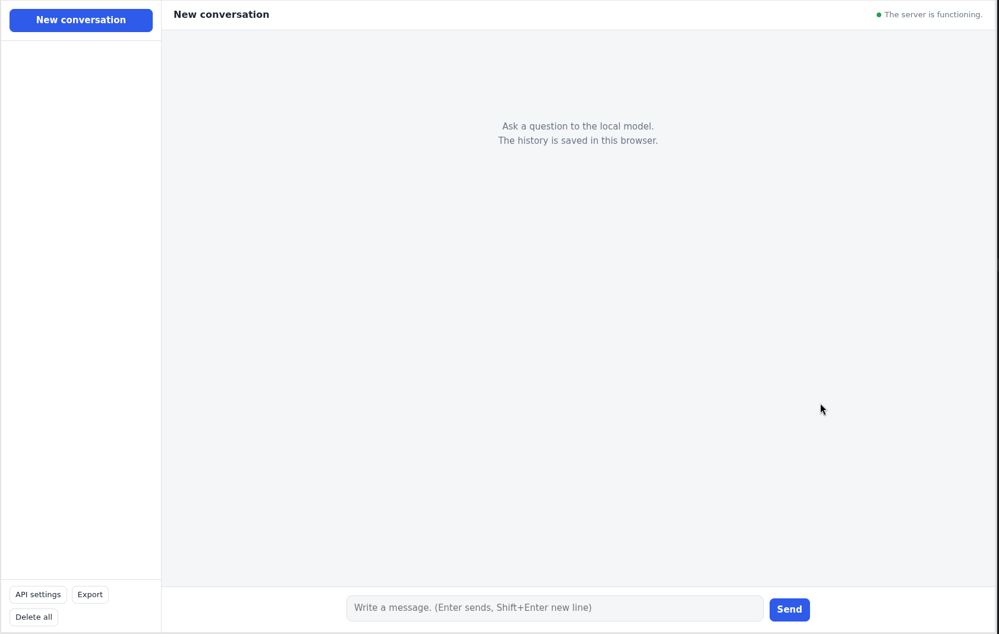

# AI Chat for local model - text-to-text

by @bakkrz 2026

-------
## Here's a simple example of a frontend for connecting to a local AI model.

AI Chat is a simple service built using Python Flask that allows you to use a chat with a local SLM or LLM model. 

## Configuration
The configuration is contained in environment variables in the config.sh file. There are two language versions of index.html - Polish and English. You only need to change the settings in the app_server.py file to start the service. 

## Screenshoot

   

-----
# PL

# AI Chat dla localnego modelu SLM lub LLM - text na text

## Jest bardzo prosty przykład frontend dla podpięcia się pod lokalny model AI.

AI Chat to prosty serwis oparty na Python Flask który umożliwia używanie chata z użyciem lokalnego modelu SLM lub LLM. 

## Konfiguracja
Konfiguracja jest zawarta w zmiennych środowiskowych w pliku config.sh. Występują dwie wersje językowe index.html - w języku Polskim i index_en.html w języku Angielskim. Wystarczy tylko zmienić ustawienia w pliku który uruchamia serwis, czyli app_server.py. 

----

History:
version 1.1 